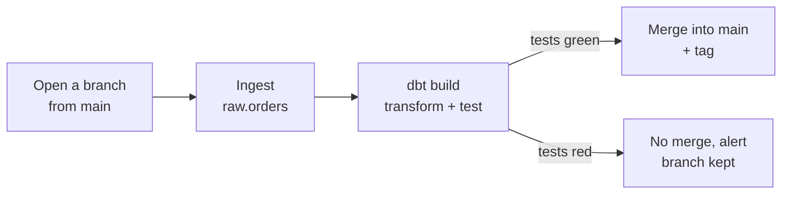

# Nessie demo: a *branch, test, merge* pipeline on an Iceberg lakehouse

A demo of **Project Nessie**, a Git-like versioned catalog for Iceberg tables. A data pipeline processes new data **on an isolated branch**, **tests it with dbt**, and **merges into `main`** only if the tests pass. Otherwise the bad data stays on its branch and an **alert** is raised: `main` never sees it.



Everything runs locally: Nessie, PostgreSQL (version store) and Silo (S3 storage, community fork of MinIO) in docker compose; PyIceberg, dbt and DuckDB in Python. How it fits together: [Architecture overview](docs/project/architecture.md).

## Prerequisites

- Docker with compose, running (e.g. Colima)
- [mise](https://mise.jdx.dev): tools, env vars (`mise.toml`) and tasks (`tasks.toml`) in one place; it installs [uv](https://docs.astral.sh/uv/)

## Quick start

```bash
mise trust                                   # once per clone: let mise load mise.toml
cp mise.local.toml.example mise.local.toml   # once per clone: then set the passwords (Postgres, Silo)
mise run stack-up      # start Nessie + Postgres + Silo, create the bucket and the raw / marts namespaces
mise run pipeline-ok   # nominal run: branch -> ingest -> dbt build (green) -> merge into main
mise run pipeline-ko   # failing run: bad data -> red tests -> no merge + alert
```

`mise tasks` lists every task; each component's README says how to run it.

## Components

One folder per responsibility, each with its README ([how they connect](docs/project/architecture.md#components)):

| Component | What it does |
|---|---|
| [`stack`](stack/README.md) | Nessie, PostgreSQL and Silo in docker compose, and the bootstrap that prepares `main` |
| [`lakehouse-client`](lakehouse-client/README.md) | Python library: Nessie API client, PyIceberg catalog and DuckDB access to a branch, settings |
| [`ingestion`](ingestion/README.md) | Synthetic orders appended to `raw.orders` (dirty ones with `--ko`) |
| [`transformation`](transformation/README.md) | The dbt project: models and tests, run on a branch |
| [`orchestration`](orchestration/README.md) | The pipeline: branch, ingest, dbt build, merge or alert |
| [`exploration`](exploration/README.md) | marimo notebook to query any branch |

## Documentation

- [Architecture overview](docs/project/architecture.md): the flow of a run, how the components connect, who reads and writes what.
- [Concepts](docs/concepts/README.md): Iceberg and Nessie, valid outside this repository, in reading order.
- [Architecture decision records](docs/adr/README.md): what was decided, why, what was ruled out.
- [How to manage the dependencies](docs/project/dependency-policy.md): version specifiers, dependencies per component, upgrades, vulnerability check.
- [How to write the documentation](docs/project/documentation.md): where each piece of documentation goes.
- Working with the coding agent: [Agent setup reference](docs/project/agent-setup.md), and the agentic layer in [`00-agentic/`](00-agentic/README.md) (working agreements, processes, ticket backends).
- The talk, in French: [Iceberg refresher deck](docs/presentation/iceberg.html), [Nessie demo deck](docs/presentation/presentation.html), [guided REPL walkthrough](docs/presentation/demo-cli.md).
