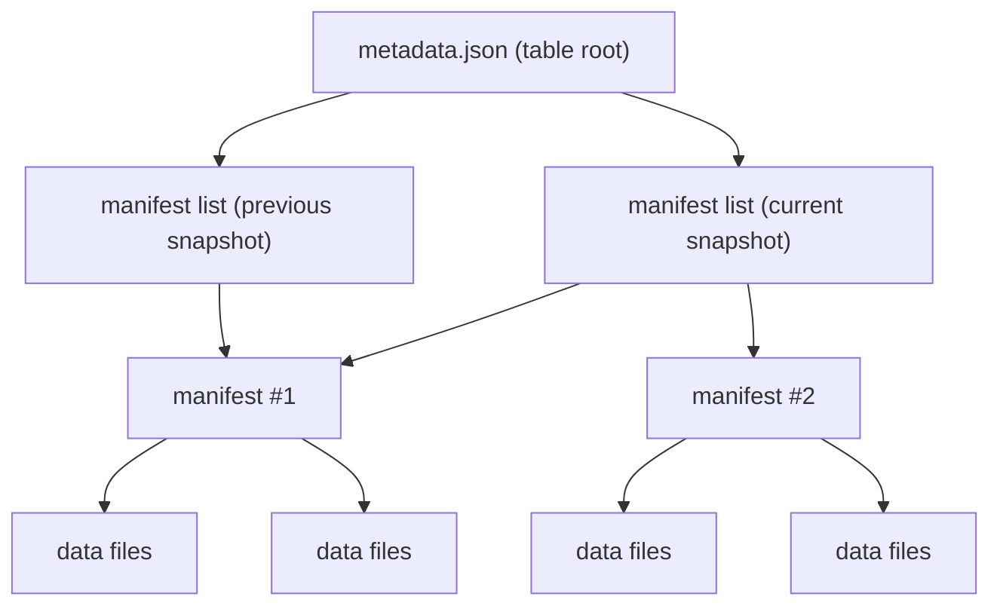

Good intro to what is iceberg: https://www.youtube.com/watch?v=TsmhRZElPvM

# Apache Iceberg metadata model (quick guide)

This explains how Iceberg stores table metadata, manifests, and data files. Manifests remain in your warehouse (MinIO/local FS).

## Concepts: metadata, table states, snapshots, commits, travel
- **Current metadata:** The active `metadata.json` file (latest table metadata file).
- **Previous metadata:** Older `metadata.json` files kept on disk until expired/pruned.
- **Current table state:** The snapshot referenced by `current-snapshot-id` in the current metadata, plus its schema/spec/sort IDs.
- **Previous table states:** Older snapshots listed in the current metadata, plus the schemas/specs they reference (also present in the metadata).
- **Snapshot:** A point-in-time view (ID, timestamp, manifest list) of the table’s files; created by each Iceberg commit that changes data/metadata.
- **Commit:** An Iceberg operation that writes data/manifest changes and produces a new `metadata.json` (advances the table).
- **Time travel:** Read a past snapshot by ID/timestamp; the engine follows the snapshot list (and metadata log if needed) to older manifest lists/manifests, as long as those snapshots/files are retained (not expired).
- **Rollback:** Change the current table state to a prior snapshot; writes a new `metadata.json` pointing `currentSnapshotId` to that older snapshot. The snapshot you rolled back from stays in the snapshot list unless expired.

## Metadata hierarchy (overview then details)
- Overview flow: `metadata.json` (current table state) → manifest list → manifests → data/delete files.
- Each Iceberg commit produces a **new metadata.json** for the table.

Details:
- **Table root metadata (`metadata.json`)**
  - Table identity/properties: UUID, table properties (e.g., write options, custom props).
  - Schemas (plural): list of schemas with schema IDs; `current-schema-id` marks the one used by the current snapshot. Older schemas stay so older snapshots remain readable.
  - Partition specs (plural): list of specs with spec IDs; `default-spec-id` marks the one used by the current snapshot. Older specs stay to interpret older manifests/snapshots.
  - Sort orders (plural): list of sort orders with IDs; `default-sort-order-id` marks the current one.
  - Snapshots: list of snapshots (IDs, parent IDs, timestamps, manifest list locations, summaries); `current-snapshot-id` marks the active snapshot.
  - Snapshot log: chronological log of snapshot IDs and timestamps.
  - Metadata log: pointers to prior `metadata.json` files (timestamp + path) for concurrent safety/history.
  - Pointers to current manifests: via `current-snapshot-id` → manifest list → manifests → data/delete files.
  - Written on every Iceberg commit (append, overwrite, rewrite/compaction, schema/partition changes). Each commit creates a new `metadata.json`; old ones stay on disk for history/time travel.
  - Grows over time because it accumulates snapshot entries and schema/spec/sort history, but it does not embed manifests or data files. Snapshot expiration/pruning can shrink it by dropping old entries.
- **Manifest list (`snap-<id>-1-...avro`)**
  - Enumerates all manifest files for a given snapshot, plus summary stats and flags (added/kept/removed).
  - Carries partition bounds and counts to allow skipping entire manifests during planning; defines the exact membership of the snapshot (union of its manifests).
  - Immutable once written; a new manifest list is created for each new snapshot. `currentSnapshotId` in `metadata.json` points to the active one.
- **Manifests (`*.avro`)**
  - List data files and delete files with rich metadata: content type (data/delete), file path, format, partition tuples, record count, size, column stats (min/max/null counts), sort order ID, and sequence numbers.
  - Enable pruning: partition bounds and stats let planners skip entire manifests that cannot match predicates.
  - Include delete files (position/equality) and their targeting info so readers can apply row-level deletes.
  - Reference a partition spec ID; readers use specs in `metadata.json` to interpret partition tuples.
  - Immutable per snapshot; new snapshots may reuse or replace manifests (e.g., after compaction). Stored in the warehouse alongside data and manifest lists.
- **Data files / delete files**
  - Parquet/ORC/Avro data and position/equality delete files stored in the warehouse (MinIO/local).
  - Written/removed by the engine; manifests record their presence.

## Snapshots
- Each table snapshot has its own manifest list and set of manifests. Snapshot entries (IDs, timestamps, parent IDs, manifest list paths, summaries) are stored as a list inside the current `metadata.json`.

## Writes and compaction
- Appends add data files and update manifests; a new snapshot is created.
- Compaction/rewrite can produce new manifests and data files; the root `metadata.json` changes and gets committed.
- Expired snapshots may orphan older manifests/data files; a `DELETE` job or `expire_snapshots` can clean them up.

## Partitioning
- Partition specs live in `metadata.json` (multiple over time, each with a spec ID). Changing the spec adds a new ID; old files keep their original spec ID.
- Transforms (e.g., `identity(col)`, `day(ts)`, `month(ts)`, `bucket(16, user_id)`, `truncate(16, url)`) define partition values per file; stored as partition tuples in manifest entries.
- Partition pruning: query predicates intersect with partition tuples to skip manifests/files without touching data.

## Stats
- Manifests store per-file stats: record count, file size, partition tuple, and column stats (min/max/null counts), plus sequence numbers and sort order IDs.
- Partition bounds and stats support coarse (manifest-level) and finer (file-level) pruning and incremental planning.
- Manifest lists summarize manifests, enabling an earlier pruning stage.

## Clustering / sorting
- Sort orders are defined in `metadata.json` with IDs; `default-sort-order-id` marks the current one.
- Sort order is advisory: writers/compaction jobs should write data in that order to improve locality and pruning.
- Manifests record sort order IDs for files; readers can leverage them alongside stats for better planning (e.g., delete application and range pruning).

## Why keep old `metadata.json` files?
- The current `metadata.json` carries history (snapshot log, schema/spec history), but older metadata files are still needed because:
  - **Isolation for readers:** A query started on metadata F keeps using F even after G is written; F must exist until snapshot expiration/orphan cleanup deems it safe to drop.
  - **Rollback/time travel safety:** You can repoint to an earlier metadata file/snapshot list if you need to recover or audit, as long as the file and its manifests still exist.
  - **Concurrency detection:** The metadata log chain proves what metadata file a committer saw; deleting links breaks optimistic concurrency checks.
  - **Recovery/debug:** Old files record prior schemas/specs/snapshots/properties exactly as they were.
  - **Cleanup boundary:** Until snapshots are expired and orphan files removed, old metadata may still reference live snapshots/files; removing them early is unsafe.

## Time travel / rollback
- **Time travel:** Query a past snapshot by ID or timestamp. The current `metadata.json` still points to the latest snapshot, but you instruct the engine to read an older one. This works while that snapshot and its metadata/manifest files are retained (not expired/pruned).
- **Rollback:** Change the table’s current snapshot to an older one. This writes a new `metadata.json` whose `currentSnapshotId` points to that older snapshot and manifest list. No manifests/data are copied; only the pointer changes, and the snapshot you rolled back from remains in the snapshot list (still accessible for time travel unless expired).
